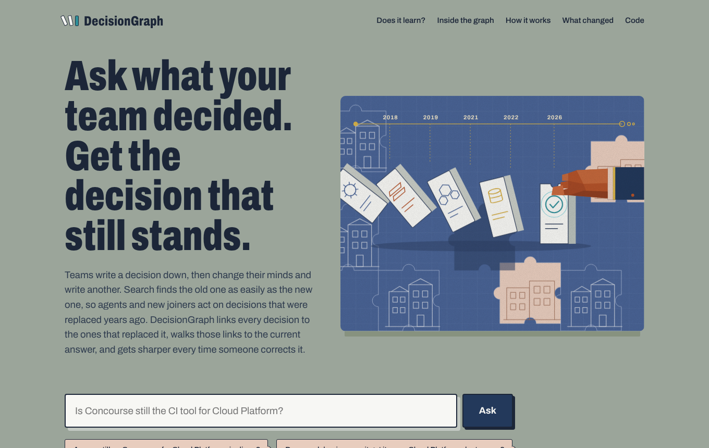
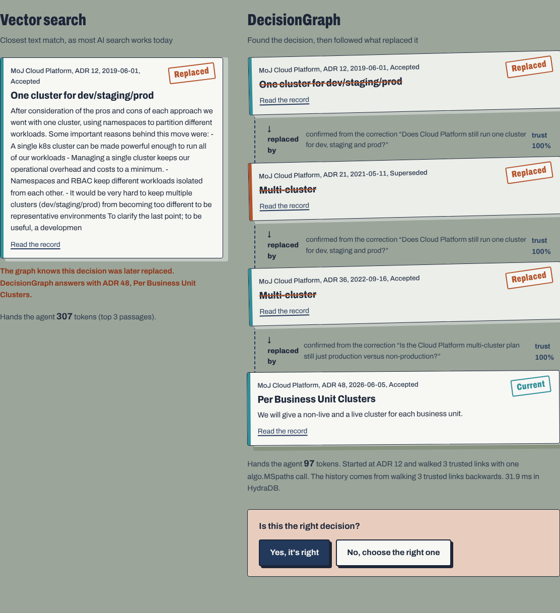
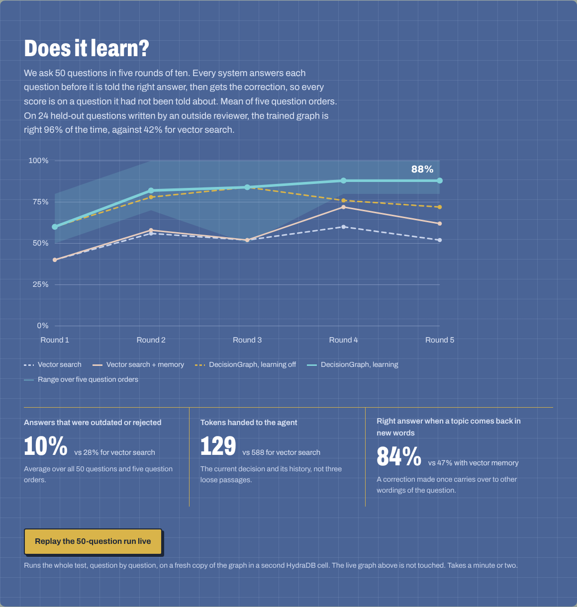
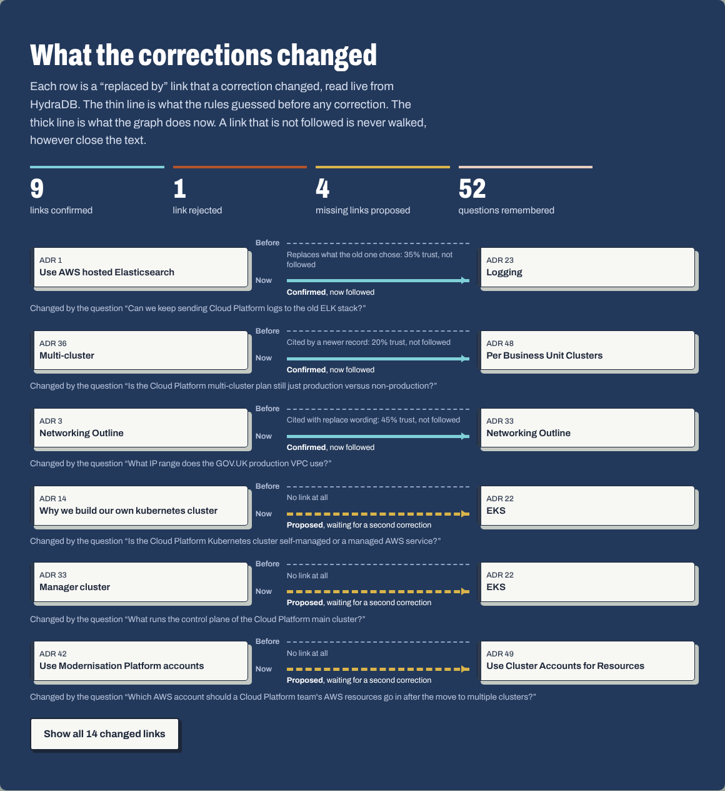
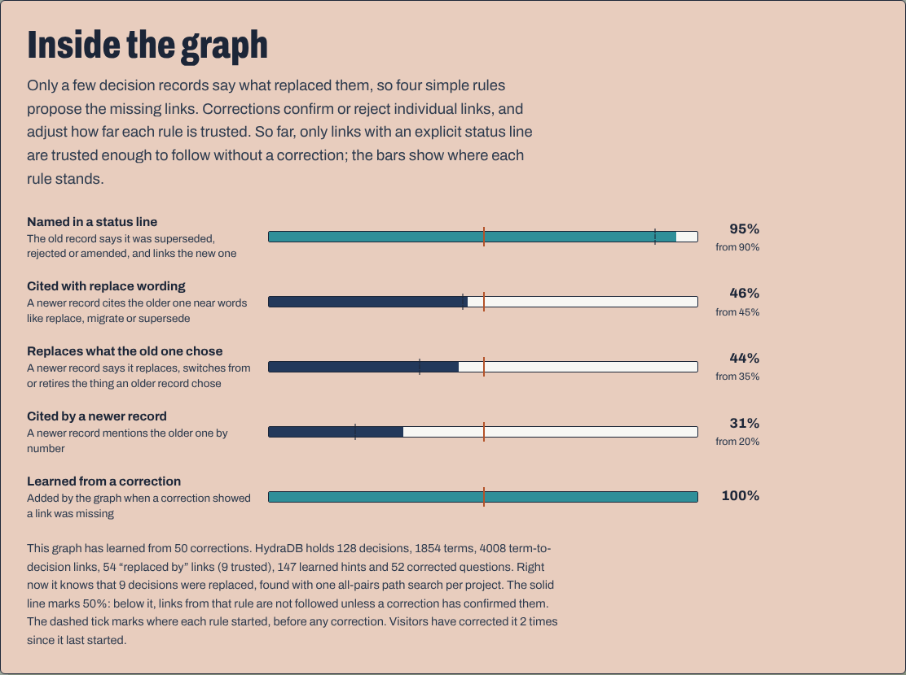

# DecisionGraph

**Ask what your team decided. Get the decision that still stands.**



Teams write decisions down, then change their minds and write new ones. Most never mark the old record as replaced. Search finds the old record as easily as the new one, so AI agents and new joiners act on decisions that were replaced years ago.

DecisionGraph keeps decisions in [HydraDB](https://github.com/hydra-db/hydradb) as a graph, linking each decision to the decisions that replaced it. A question lands on the decision it is about. A single `algo.MSpaths` call inside HydraDB then follows trusted "replaced by" links to the decision that still stands. Every correction is stored in the graph as a question node, and it changes the graph: links are confirmed or rejected, new links are proposed, and the question's words are pointed at the right topic.

Built for the HydraDB Hackathon (Nov 14–16, 2026). It covers **Track 1, a graph that improves itself**, and **Track 2, a context layer for agents** (it has an MCP server).

- **Live app:** https://decisiongraph-latest.onrender.com/ (free host: the first visit after a quiet spell can take about a minute to wake up)
- **Walkthrough video:** _add the YouTube link here_
- **Use it from an agent:** an MCP server in [`agent/`](agent/decisiongraph_mcp.py)

### One question, two answers

Asked *"Does each business unit get its own Cloud Platform cluster now?"*, vector search returns the closest text: a 2019 decision to run one cluster, replaced three times since. DecisionGraph lands on the same record, then walks the "replaced by" links in HydraDB to the decision that stands today, and hands the agent that decision and its history in 97 tokens instead of 307.



## Results

### The learning curve

The test set is 50 hand-written questions about 128 real architecture decision records (ADRs).

**How the test runs:** questions are asked in five rounds of ten. Every system answers each question **before** it is told the right answer, then receives the correction (test-then-train). Mean over five different question orders. Reproduce with `python -m app.evaluate`; every number is in `data/results.json`.

| System | Right decision | Outdated or rejected answer | Round 1 → round 5 | Topic seen before, in new words | New topic |
|---|---|---|---|---|---|
| Vector search (MiniLM, top 3 passages) | 52% | 28% | 40% → 52% | 33% | 64% |
| Vector search + memory of past corrections | 57% | 22% | 40% → 62% | 47% | 63% |
| DecisionGraph seeding only, no walk (ablation) | 62% | 32% | 46% → 58% | 45% | 72% |
| DecisionGraph, learning off | 74% | 18% | 60% → 72% | 61% | **82%** |
| **DecisionGraph, learning on** | **80%** | **10%** | 60% → **88%** | **84%** | 78% |



### What the numbers do and don't show

**The walk does work a vector store can't.**
- With identical seeds, following "replaced by" links takes accuracy from 62% to 74%.
- It cuts outdated answers from 32% to 18%.
- The other ten points over plain vector search come from term structure and a project filter in the seeding step. That step is cheap, but it isn't the graph walk.

**The learning is real, and it is learning about topics.**
- Learning on versus off, round by round: 0, +4, 0, +12 and +16 points.
- When a topic comes back in different words, the learning graph is right 84% of the time. Learning off scores 61%, and vector search with a memory of past corrections scores 47%.

**It has a cost on brand-new topics.** Accuracy on topics never corrected before drops from 82% to 78%, because hints learned for one topic sometimes pull a different question towards it. We report this rather than hide it.

**Rule trust is learned but doesn't yet change behaviour.**
- After 50 corrections, the inferred rules end at 0.31–0.46 trust. That is below the 0.5 follow line, so on this data the gains come from links confirmed one at a time, and from topic memory.
- The "status line" rule ends at 0.95.

**Tokens:** the agent gets about 130 tokens instead of about 590. That is because DecisionGraph returns one decision and its history instead of three passages. It is a consequence of knowing which decision is current, not a separate trick.

### What the corrections changed

The page reads this straight from HydraDB (`GET /api/learned`). After the 50 test corrections: 9 "replaced by" links confirmed, 1 rejected, 4 missing links proposed and waiting for a second correction, and 50 questions kept as nodes. Each row shows what the rules guessed before any correction, what the graph does now, and the question that changed it.



Rule trust moves too. The dashed tick is where each rule started; the solid line is the 50% follow line.



### Held-out questions (not used for tuning)

`data/heldout.json` holds 24 questions written by a separate reviewer during an outside review of this project:
- 14 revisit test topics in new words.
- 10 are about topics the test never asks.

The file also has 12 out-of-scope questions with no answer in the records, such as "What is our parental leave policy?".

| System | Revisited topics | New topics | All held-out | Says "no decision on record" when out of scope |
|---|---|---|---|---|
| Vector search | 21% | 70% | 42% | 100% |
| Vector search + memory | 86% | 70% | 79% | 100% |
| DecisionGraph, learning off | 57% | 100% | 75% | 100% |
| **DecisionGraph, after learning** | **93%** | **100%** | **96%** | 92% |

Both systems use the same abstention rule: if nothing scores above 0.42, they answer "no decision on record" instead of guessing.

## How it works

```
question ─► seeds: vector similarity + (:Term)-[:CORE_OF]->(:Decision)
                   + learned (:Term)-[:HINTS]->(:Decision)
                   + past corrections (:Term)-[:IN_QUESTION]->(:Question)-[:ABOUT]->(:Decision)   (2 hops in HydraDB)
         ─► walk:  one CALL algo.MSpaths over (:Decision)-[:REPLACED_BY {cost}]->(:Decision)
                   cost = 1 for trusted links, 100 for untrusted ones, maxCost = 5
         ─► answer: the decision that still stands + its history (walked backwards the same way), ≈130 tokens
                   or "no decision on record" when nothing is close enough
feedback ─► a (:Question) node + (:Question)-[:RESOLVED_TO]->(:Decision)
            confirm or reject the links it walked (r.state, r.w, r.cost, r.by = the question)
            propose a missing link (followed only after a second correction needs it)
            update rule trust and push it to every unjudged link of that rule in one SET
            point the question's words at the topic: the oldest decision in the trusted chain
```

**Graph model (all in HydraDB):**

| Node / edge | Meaning |
|---|---|
| `(:Decision {key,title,status,date,project})` | one ADR |
| `(:Project)-[:HAS]->(:Decision)` | which platform it belongs to |
| `(:Term)-[:CORE_OF]->(:Decision)` | terms from the ADR's title and decision |
| `(:Decision)-[:REPLACED_BY {rule,state,w,cost,reach,by}]->(:Decision)` | "this was replaced by that"; `state` is candidate, pending, confirmed or rejected; `cost` is the walking cost; `by` is the question that confirmed it |
| `(:Term)-[:HINTS {w}]->(:Decision)` | learned: these words point at this topic |
| `(:Question {text,nterms})-[:RESOLVED_TO]->(:Decision)`, `-[:ABOUT]->`, `(:Term)-[:IN_QUESTION]->` | every correction, kept as data |
| `(:Rule {name,a,b})` | how far each link rule is trusted (Beta counts) |

**HydraDB features used:**
- `algo.MSpaths` with `costProp`/`maxCost` for the walk, the history, reachability during learning, and the "how many decisions do we know were replaced" count. That count is one all-pairs call per project.
- Multi-hop `MATCH` with grouped aggregation for question memory.
- `MATCH … WHERE … SET` on relationship properties for trust propagation.
- `UNWIND` batch writes for loading.
- A second cell (`cell-1`), so the page's live replay runs on a fresh copy without touching the graph visitors teach.

**Link rules.** Four rules propose `REPLACED_BY` links. Only 6 of the 50 proposed links come from an explicit "superseded by" line; the rest have to be inferred, which is why trust matters.

| Rule | Example | Starting trust |
|---|---|---|
| status-link | "Superseded by [036]" in the status section | 0.90 |
| body-ref-replace | a newer ADR cites an older one near "replace", "migrate" or "supersede" | 0.45 |
| replace-term | a newer ADR says it replaces or switches from the tool an older ADR chose | 0.35 |
| body-ref | a newer ADR cites an older one by number | 0.20 |

**Guards against learning the wrong thing:**
- A correction only confirms a path if every hop links related decisions, or is backed by an explicit status line.
- A brand-new link is only proposed: it is followed once a second correction needs it.

**Compared with related work:**
- HydraDB's own [SelfGraph](https://github.com/hydra-db/selfgraph) retires a fact when a newer one is written with an explicit supersession.
- Real decision records rarely say what replaced them. DecisionGraph infers those links, learns from corrections which ones to trust, and measures that against baselines.

## Use it from an agent

`agent/decisiongraph_mcp.py` is an MCP server with three tools:

| Tool | What it does |
|---|---|
| `current_decision(question)` | The decision that still stands, the decisions it replaced, the source link and its id. Says "no decision on record" instead of guessing. |
| `find_decisions(search)` | Decision titles matching the words, with the ids `correct_decision` needs. |
| `correct_decision(question, correct_decision_id)` | Teaches the graph; returns what changed and what it answers now. |

```bash
pip install -r agent/requirements.txt
claude mcp add decisiongraph -e DECISIONGRAPH_URL=https://decisiongraph-latest.onrender.com -- python agent/decisiongraph_mcp.py
```

A session from a real MCP client (`mcp` 2.x, stdio):

```text
> current_decision("Is Concourse still the CI tool for Cloud Platform?")
CURRENT DECISION: Use GitHub Actions (MoJ Cloud Platform, ADR 40, 2026-01-02, status: accepted)
Decision: We will switch to using GitHub Actions for our deployment pipelines.
Source: https://github.com/ministryofjustice/cloud-platform/blob/main/architecture-decision-record/040-use-github-actions.md
Decision id: cloud-platform:40

> current_decision("What's the best pizza topping?")
No decision on record answers this question. Don't assume one exists; ask the team.

> find_decisions("eks")
cloud-platform:22  MoJ Cloud Platform · ADR 22 · EKS
cloud-platform:34  MoJ Cloud Platform · ADR 34 · EKS Fargate
cloud-platform:45  MoJ Cloud Platform · ADR 45 · Use a Private EKS Endpoint

> correct_decision("x", "cloud-platform:999")
Error: That decision id doesn't exist. Use find_decisions to get the right id.
```

The same thing is available over HTTP: `POST /api/ask {"q": "..."}` returns `graph.context`, and `POST /api/feedback {"q": "...", "correct": "cloud-platform:48"}` teaches the graph.

## Who it's for

Platform and engineering teams with dozens of decision records (ADRs, RFCs, design docs) who let coding agents work in their repos. Every outdated decision an agent acts on becomes a review comment, a revert or an incident.

How it would be sold:
- Open source and self-hosted: free.
- Hosted Team, up to 1,000 decisions: $49 a month.
- Organisation, with every repo, SSO and an audit trail of corrections: $199 a month.

## Run it locally

You need HydraDB's `graph-node` (build it from [hydra-db/hydradb](https://github.com/hydra-db/hydradb)) and Python 3.11+.

```bash
pip install -r requirements.txt
# start graph-node with the environment in start.sh (local store, cells cell-0 and cell-1)
python -m app.evaluate                     # reproduce data/results.json (about 2 minutes)
uvicorn app.server:app --port 8000         # the web app
```

Or use the single container that runs both: `docker build -t decisiongraph . && docker run -p 10000:10000 decisiongraph`.

To rebuild `data/adrs_raw.json` from the source repositories, see `scripts/parse_adrs.py`.

## Deploy (free)

1. GitHub Actions (`.github/workflows/image.yml`) builds HydraDB from source at a pinned commit, together with the app, and publishes `ghcr.io/0xnexuz/decisiongraph:latest`.
2. Render's free tier runs the image. HydraDB runs in the same container with local storage and small caches, using about 300 MB of RAM.
3. `.github/workflows/keep-awake.yml` pings the app every 10 minutes.

On startup the app builds the graph and teaches it the 50 test corrections, so the demo starts from a graph that has already learned.

## Honest limits

- 50 test questions over 128 ADRs is a small test. The test questions and the graph's constants were written and set by us; the held-out questions were written by a separate reviewer and not used for tuning.
- At this size, a plain Python dictionary could hold the same graph. HydraDB runs the traversals, path searches and trust updates here, and is what would let this grow to an organisation's full decision history.
- Learning slightly lowers accuracy on brand-new topics (82% → 78%), as described above.
- The demo's corrections are shared by everyone using it. Each new correction only proposes a link, and replays run in a separate cell.
- Restarting the app rebuilds the graph from scratch. Note for HydraDB: a restarted `graph-node` numbers HTTP queries from 1 again, so reusing an old store can collide with stored idempotency keys. `start.sh` starts from an empty store for this reason.

## Data and licences

- Decision records: [ministryofjustice/cloud-platform](https://github.com/ministryofjustice/cloud-platform), [ministryofjustice/modernisation-platform](https://github.com/ministryofjustice/modernisation-platform) and [alphagov/govuk-aws](https://github.com/alphagov/govuk-aws), all MIT. See `data/SOURCES.md`.
- HydraDB: [hydra-db/hydradb](https://github.com/hydra-db/hydradb), Elastic License 2.0, built from source.
- Embedding model: all-MiniLM-L6-v2, Apache 2.0 (`models/minilm/LICENSE`). Font: Archivo, SIL Open Font License.
- This repository: MIT.
